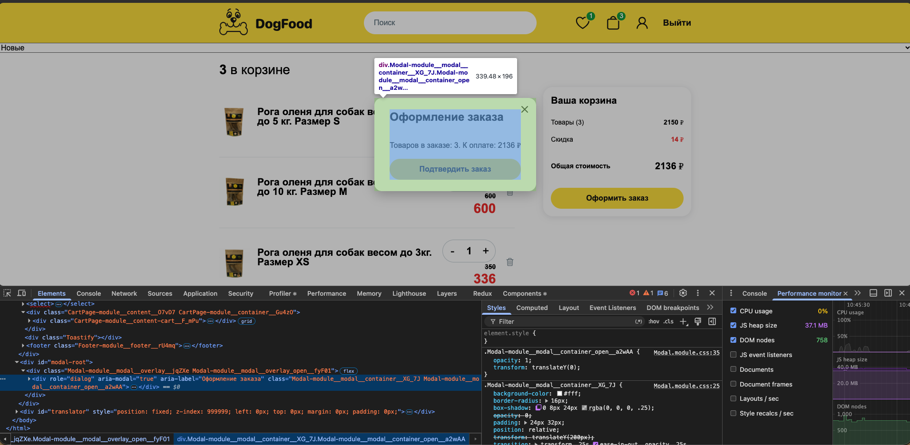
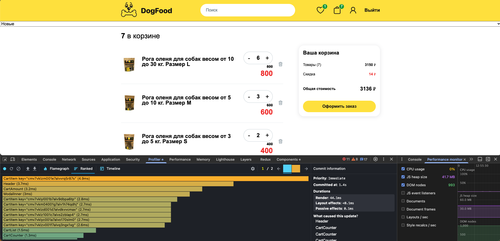
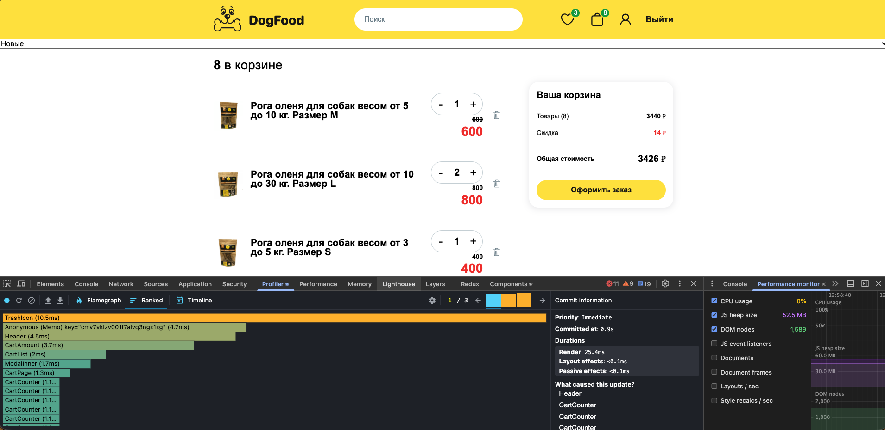
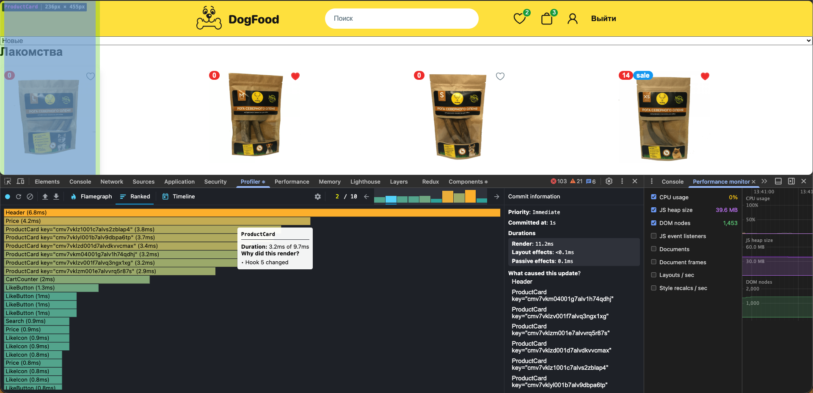
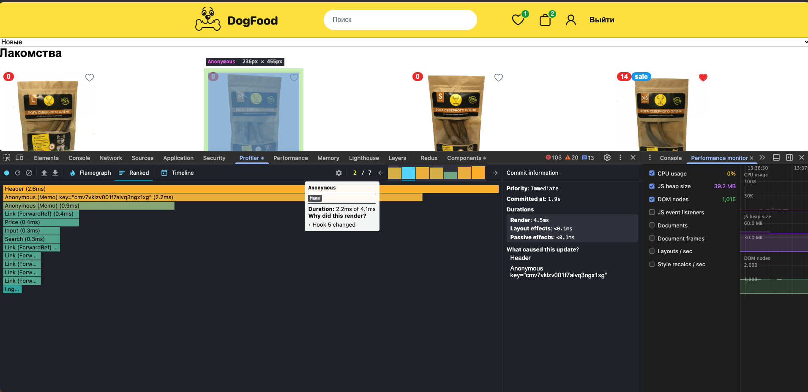

# React PRO — финальный проект

Доработка готового интернет-магазина: архитектура, оптимизация рендеров, React Portal, `useRef`,
альтернативная сборка на Vite + SWC и React 19.

---

## Что сделано

- **Переработана структура проекта** — код разложен по слоям `app` / `pages` / `widgets` / `features` / `shared`;
  UI-компоненты вынесены в `src/shared/ui`, бизнес-логика — в `src/features/*`.
- **Модальное окно через React Portal** — `src/shared/ui/Modal`, рендерится в `#modal-root` из `index.html`.
  Закрывается по `Escape`, по клику на overlay и по кнопке «×», управляет фокусом: при открытии фокус уходит
  на кнопку закрытия, при закрытии возвращается на элемент-триггер.
- **`useRef` в двух сценариях** — хранение значения между рендерами без перерендера и работа с DOM.
- **Оптимизация рендеров** — найдены лишние рендеры списков через React DevTools Profiler, применены
  `React.memo`, `useMemo` и `useCallback` (подробности в разделе «Оптимизация»).
- **Альтернативная сборка Vite 8 + SWC** — `vite.config.ts`, скрипт `npm run build:vite`, замеры и сравнение
  с Webpack в разделе «Сравнение сборок».
- **React 19** — `react`/`react-dom` 19.3.1, `useOptimistic` для оптимистичного лайка товара.

---

## Структура проекта

```text
src/
├── app/            # точка входа: App, провайдеры, Redux-store, глобальные стили
├── pages/          # страницы приложения (Home, Product, Cart, Favorites, SignIn, SignUp, Profile, NotFound)
├── widgets/        # составные блоки страниц (CardList, Header, Layout, ReviewList, …)
├── features/       # бизнес-фичи
│   ├── auth/       #   авторизация и регистрация
│   ├── cart/       #   корзина: слайс, счётчики, CartAmount, CartItem
│   ├── favorites/  #   избранное: LikeButton с useOptimistic
│   ├── products/   #   каталог: RTK Query API, ProductCard, списки, пагинация
│   └── search/     #   поиск и сортировка
└── shared/         # переиспользуемый код без бизнес-логики
    ├── ui/         #   Button, Input, Modal, Loader, Rating, Price, …
    ├── api/        #   базовый query для RTK Query
    ├── hooks/      #   useDebounce и др.
    ├── lib/        #   WithQuery и вспомогательные обёртки
    ├── store/      #   типизированные useAppSelector / useAppDispatch
    ├── types/      #   глобальные типы (Product, CartProduct, Review, …)
    ├── utils/      #   утилиты (getMessageFromError, isLiked, …)
    └── assets/     #   иконки и изображения
```

Правила слоёв: `shared` не знает о `features` и `pages`; фичи не импортируют друг друга напрямую,
кроме публичных точек входа (`features/*/ui/...`); страницы собирают фичи и виджеты.

---

## Сравнение сборок

Сравнивались webpack-сборка из стартового проекта и добавленная альтернативная на Vite + SWC.
Замеры сняты на Node 22.13.1, macOS, по 3 прогона каждой сборки подряд; время — от запуска npm до выхода процесса.

Исходники при замерах одинаковые: `src/`, `package.json`, `webpack/`, `vite.config.ts`, `tsconfig*.json`,
`index.html` и `postcss.config.js` совпадают с базой побайтово.

| Сборщик                                               | Прогон 1 | Прогон 2 | Прогон 3 |    Среднее |         Размер артефактов |
| ----------------------------------------------------- | -------: | -------: | -------: | ---------: | ------------------------: |
| **Webpack 5 + ts-loader** (`npm run build` → `dist/`) |  44.09 с |  42.87 с |  42.11 с | **43.0 с** | **685 555 Б** (≈ 670 КиБ) |
| **Vite 8 + SWC** (`npm run build:vite` → `build/`)    |  21.20 с |  21.80 с |  21.27 с | **21.4 с** | **659 178 Б** (≈ 644 КиБ) |

Итого: Vite быстрее в **~2 раза** (21.4 с против 43.0 с), бандл меньше на **26 377 Б** (≈ 3.8 %).

Состав артефактов:

| Файл               |                Webpack |                        Vite |
| ------------------ | ---------------------: | --------------------------: |
| JS                 |              631 455 Б |                   601 230 Б |
| CSS                |               51 196 Б |                    44 201 Б |
| `*.js.LICENSE.txt` |                2 532 Б |                           — |
| SVG (``)  | внутри JS (url-loader) | 13 268 Б отдельными файлами |
| `index.html`       |                  372 Б |                       479 Б |

Почему vite-цифра 21.4 с включает не только сам Vite: внутри `npm run build:vite` сначала идёт
`tsc --noEmit -p tsconfig.vite.json` (отдельно ≈ 14.2 с), потом `vite build` (≈ 13.3 с, на прогретом кэше ≈ 8.6 с).
Webpack тоже проверяет типы, но внутри `ts-loader`, поэтому там это одна цифра.

Три отличия, которые сознательно не выравнивались:

- **нет `main.<hash>.js.LICENSE.txt`** — Rolldown поддерживает только `legalComments: 'none' | 'inline'`,
  отдельный файл писать не умеет;
- **хэш короче** (`DLAEdZRs` против `39eb82e723e77a4269c0`) — Rolldown использует base64, webpack — hex;
- **svg у Vite вынесены в файлы** `static/images/`, у webpack вшиты в JS через `url-loader`.

---

## Оптимизация

Анализ проводился через **React DevTools → вкладка Profiler** с включённой опцией
«Record why each component rendered while profiling». Снимались два сценария: клик по кнопке
«В корзину» на главной странице и изменение количества товара на странице корзины.

### Что нашлось

**1. `ProductCard` (`src/features/products/ui/ProductCard`)**

Каждая карточка каталога подписывалась на **весь массив корзины**:

```ts
const cartProducts = useAppSelector(cartSelectors.getCartProducts)
const isProductInCart = cartProducts.some((p) => p.id === id)
```

Редуктор `addCartProduct` пересобирает массив (`state.products = [...state.products, payload]`),
поэтому добавление одного товара в корзину давало новую ссылку на массив **всем** карточкам,
и весь грид перерисовывался, хотя у 19 из 20 карточек признак «в корзине» не изменился.
Плюс `onClick={() => addProductToCart(...)}` создавал новую функцию на каждый рендер.

**2. `CartItem` (`src/features/cart/ui/CartItem`)**

Причина та же, но со стороны редуктора: `setCartProductCount` собирал новый объект для **каждого**
товара через `.map((p) => ({ ...p, count: ... }))`. Изменение количества у одной строки корзины
перерисовывало все строки.

**3. `CartCounter` / `useCount` (`src/features/cart/ui/CartCounter`)**

Хук читал весь массив корзины и искал в нём товар через `find`. Каждое изменение корзины
поднимало все смонтированные счётчики.

**4. `CartAmount` (`src/features/cart/ui/CartAmount`)**

Сумма и скидка считались двумя `reduce` прямо в теле компонента, то есть пересчитывались при
любом рендере, включая открытие и закрытие модалки оформления заказа.

### Что применено

| Место                           | Решение                                                                                                  |
| ------------------------------- | -------------------------------------------------------------------------------------------------------- |
| `ProductCard`                   | `React.memo`; селектор возвращает примитив `boolean` вместо массива; `useCallback` для `handleAddToCart` |
| `CartItem`                      | `React.memo`; `useCallback` для `handleDelete`                                                           |
| `cartSlice.setCartProductCount` | мутирует только найденный товар вместо пересборки всех объектов                                          |
| `CartCounter`                   | `React.memo` (проп `productId` — строка)                                                                 |
| `useCount`                      | подписка через `useAppSelector` на один товар вместо всего массива; обработчики в `useCallback`          |
| `LikeButton`                    | `React.memo`, `toggleLike` в `useCallback`                                                               |
| `CartAmount`                    | один `useMemo` на сумму, скидку и итог; `useCallback` для колбэков кнопок и модалки                      |

Ключевая правка — **селектор, возвращающий примитив**. `useAppSelector` сравнивает результат по ссылке,
а `boolean` сравнивается по значению, поэтому карточка перерисовывается только когда признак
«товар в корзине» у неё реально изменился.

### Результат

До: клик «В корзину» на одной карточке — в Profiler рендерятся все карточки каталога
и все смонтированные счётчики; изменение количества в корзине — рендерятся все строки `CartItem`.

После: рендерится только та карточка, у которой изменился признак, и только та строка корзины,
у которой изменилось количество. Открытие и закрытие модалки оформления заказа больше не вызывает
пересчёта суммы.

Скриншоты профилировщика «до/после» — в разделе [«Демонстрация»](#4-оптимизация-рендеров--react-devtools-profiler).

---

## Демонстрация

Все материалы лежат в папке [`profiler/`](profiler). Видео сняты Screen Recording macOS в `.mov` —
GitHub проигрывает такой формат прямо в README.

### 1. Модальное окно через React Portal

Окно рендерится не на месте кнопки, а в `<div id="modal-root">` из `index.html`. На скриншоте
панель `Elements` раскрыта: внутри `#modal-root` лежит `<div role="dialog" aria-modal="true"
aria-label="Оформление заказа">` с классом `modal__container_open`.

**`profiler/Modal_open.png`**



Закрытие: `Escape`, клик по overlay и кнопка «×». При закрытии фокус возвращается на кнопку-триггер
(`triggerRef.current.focus()` в `Modal.tsx`).

**`profiler/modal_close.mp4`**

<video src="profiler/modal_close.mp4" width="720" autoplay muted loop></video>

### 2. Управление фокусом (`useRef`)

При открытии формы логина фокус переводится на поле email через `emailInputRef` — без клика мышкой.
Второй сценарий с `useRef`: удержание `wasOpen` в модалке, чтобы фокус возвращался только при закрытии,
а не при первом монтировании.

**`profiler/focus_to_input_signInForm.mov`**

<video src="profiler/focus_to_input_signInForm.mov" width="720" autoplay muted loop></video>

### 3. `useOptimistic` — мгновенный отклик лайка

Сердечко заливается сразу по клику, не дожидаясь ответа `PUT /products/{id}/likes`; при ошибке
значение откатывается к состоянию из кэша.

**`profiler/optimistic_like.mov`**

<video src="profiler/optimistic_like.mp4" width="720" autoplay muted loop></video>

### 4. Оптимизация рендеров — React DevTools Profiler

Снимались два сценария: изменение количества товара в корзине и добавление товара в корзину из каталога.
Слева — «до», справа — «после».

| Сценарий                                | До                                | После                            |
| --------------------------------------- | --------------------------------- | -------------------------------- |
| Изменение количества в корзине          | `profiler/CardItem_before.png`    | `profiler/CardItem_after.png`    |
| Добавление товара в корзину из каталога | `profiler/ProductCatd_before.png` | `profiler/ProductCard_after.png` |

**`profiler/CardItem_before.png`**



**`profiler/CardItem_after.png`**



**`profiler/ProductCatd_before.png`**



**`profiler/ProductCard_after.png`**


